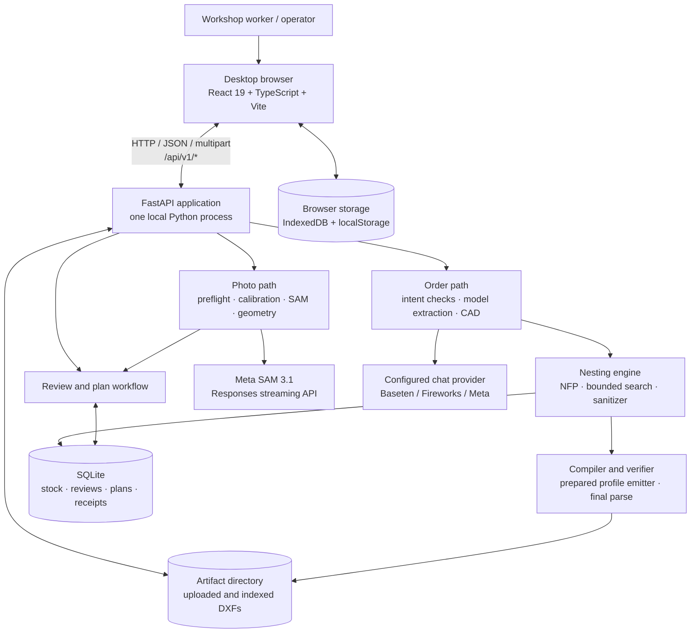
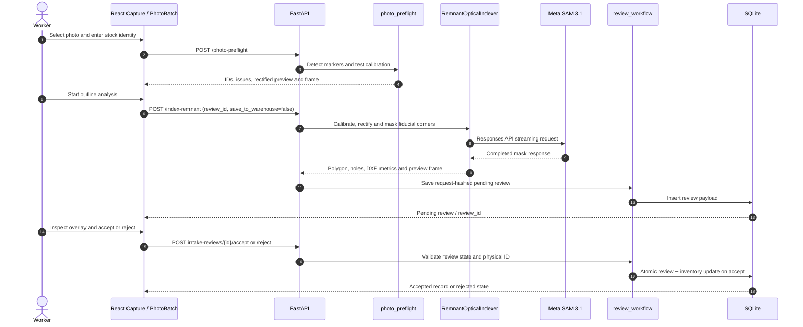
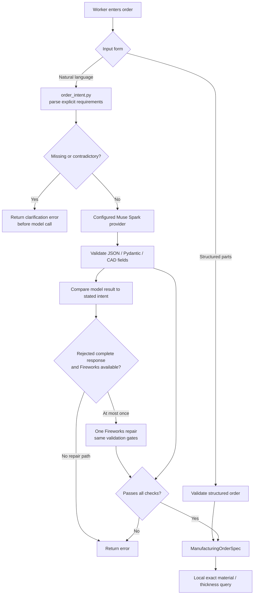
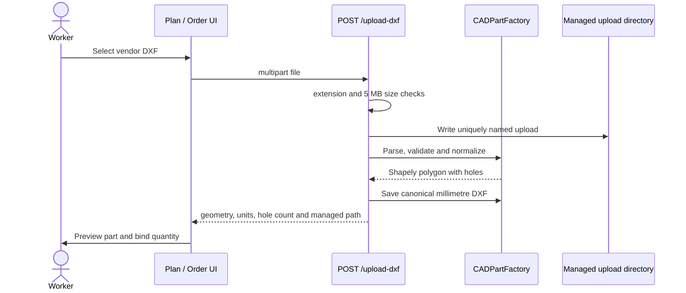
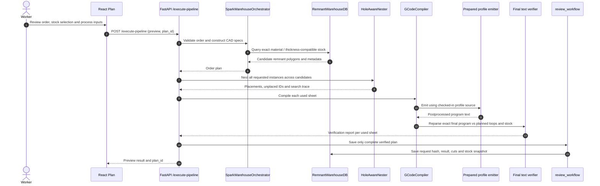
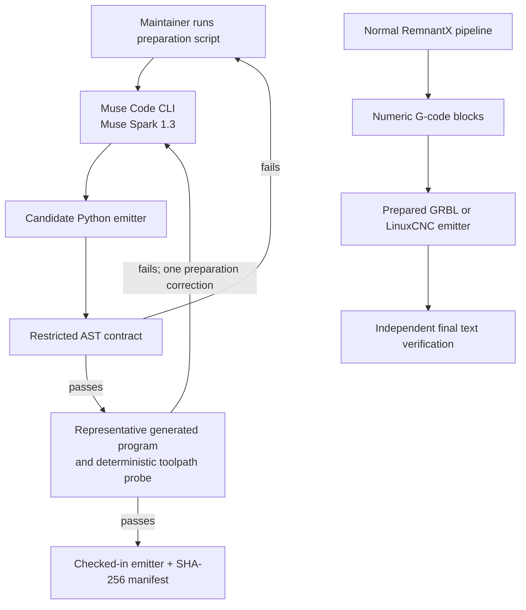
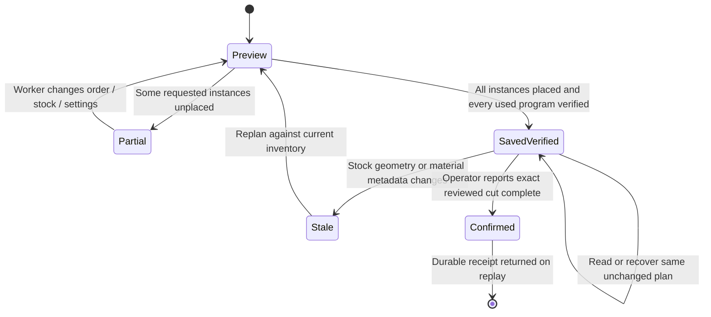
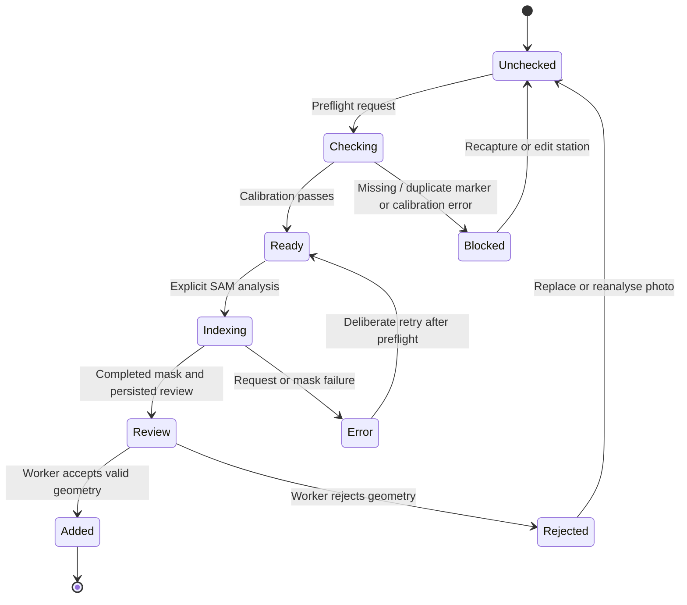

# Remnant X Architecture

**Source-audited implementation reference · 31 October 2026**

Remnant X is a desktop-first manufacturing workbench for turning photographs of sheet remnants into reviewed digital inventory, then planning requested parts against that inventory. A worker captures a remnant on a measured four-marker ArUco station, reviews the reconstructed boundary and holes, enters an order or imports vendor DXFs, inspects a multi-sheet layout and its controller programs, and explicitly records completion after the physical cut.

This document describes the implementation in this repository, not an aspirational target design. The primary code paths are in **backend/** and **Front End/src/**. Test counts and physical observations below are historical evidence recorded in the linked reports; they are not a claim that tests were rerun for this documentation update.

The most important architectural boundary is **AI-assisted interpretation versus deterministic manufacturing geometry and operator authority**:

- Meta SAM 3.1 supplies an image segmentation mask. It does not identify material grade, thickness or physical dimensions.
- Muse Spark Open interprets a natural-language order into structured part requirements. Deterministic checks compare that extraction with the user's stated requirements.
- Local geometry code selects compatible stock, constructs and nests polygons, compiles toolpaths and verifies the final emitted text.
- A worker accepts photographed stock geometry and later reports that the exact reviewed cut has physically completed.
- Remnant X does not connect to, control or receive telemetry from a cutting machine.

For setup, see [Local Startup](docs/LOCAL_STARTUP.md). For operator behavior, see [Frontend Workflows](Front%20End/WORKFLOW_GUIDE.md). For decisions and experiments, see the [Engineering Decisions site](https://nikunjtrehan.github.io/remnant-x/engineering-decisions/). Supporting evidence is in the [repository audit](docs/architecture/REPOSITORY_AUDIT.md), [application promise audit](docs/architecture/APPLICATION_PROMISE_AUDIT.md), [physical validation report](docs/architecture/PHYSICAL_VALIDATION_20261030.md) and [final integration review](docs/FINAL_READINESS.md).

## 1. System Context and Topology

### 1.1 Runtime topology



The backend stages are Python modules in one FastAPI application. M1 through M4 are **not separate services or independently deployed processes**. The API route layer delegates to workflow modules; those modules call geometry, database and model-client code directly.

During local development, Vite serves the frontend on 127.0.0.1:5173 and proxies /api to FastAPI on 127.0.0.1:8000. Requests are synchronous HTTP requests. The UI waits for a response from the current API call; there is no durable background-job queue, WebSocket progress channel or worker service. Long indexing and nesting operations occupy the request path.

The GitHub Pages site is for documentation. It does not host this application or its local API. A separately deployed frontend needs a separately configured API endpoint/reverse proxy and a deliberate security design; a successful static Pages deployment is not a live RemnantX deployment.

### 1.2 Process, locking and concurrency boundaries

| Boundary | Implemented behavior | What it does not provide |
|---|---|---|
| Photo indexing | api.py wraps /index-remnant in an in-process threading.Lock named review_lock. A retry for an in-progress reviewed scan waits for the existing operation instead of starting another inference in that process. | No distributed lock or coordination across multiple Uvicorn processes/hosts. |
| Pipeline execution | api.py wraps /execute-pipeline in a separate in-process threading.Lock named plan_lock. | No factory-wide stock reservation while a plan is being reviewed. |
| SQLite access | RemnantWarehouseDB uses a process-local re-entrant lock around connections; write workflows use SQLite transactions, including BEGIN IMMEDIATE. | No distributed job scheduler or reservation service. SQLite remains the authoritative persisted-write boundary. |
| NFP search | The nester can run a bounded number of independent annealing chains in a ThreadPoolExecutor (maximum four workers). | No unbounded search or optimality proof. |
| Photo batches | The browser processes preflight and segmentation sequentially, retaining per-photo outcomes. | No server-side batch worker; closing the page does not turn an unfinished API call into a durable queued job. |

The two API locks protect only work performed inside one application process. SQLite transactions and expected-stock comparisons protect persisted inventory updates; a plan can still become stale while waiting for operator review.

## 2. Repository and Module Architecture

### 2.1 Repository layout

```text
remnant-x/
  README.md
  ARCHITECTURE.md
  .env.example
  requirements.txt
  requirements-dev.txt

  Front End/
    src/
      App.tsx                  Workspace navigation, mode and inventory refresh
      Scanner.tsx              Single-photo scanner entry
      Capture.tsx              Station setup and individual photo workflow
      PhotoBatch.tsx           Named photo / ZIP queue and recovery
      GeometryReview.tsx       Human geometry approval
      Plan.tsx                 Order, stock selection, saved plan and completion
      OrderEditor.tsx          Structured part editor
      CuttingPlan.tsx          Layout and program result view
      SheetViewer.tsx          Sheet, geometry and toolpath rendering
      api.ts                   Typed HTTP boundary
      photo-import.ts          ZIP/photo validation and SHA-256 duplicate checks
      recovery.ts              IndexedDB and localStorage recovery
      types.ts                 Frontend API/domain contracts
      geometry.ts              Browser-side drawing helpers
      errors.ts, ui.tsx         Error presentation and shared UI
    public/example/            Recorded synthetic walkthrough
    package.json
    vite.config.ts

  backend/
    api.py                     FastAPI app factory and HTTP routes
    schemas.py                 Strict Pydantic request contracts
    serialization.py           Geometry and result serialization
    photo_preflight.py         Read-only marker/calibration preflight
    sam_client.py              Meta SAM Responses/SSE transport and mask decoder
    m1_sam_indexer.py           ArUco calibration and mask vectorization
    llm_client.py              Baseten / Fireworks / Meta chat transport
    order_intent.py             Prompt requirement and contradiction checks
    materials.py                Exact material/grade normalization
    m2_spark_orchestrator.py    Order validation, CAD construction and stock query
    db_and_parts.py             SQLite inventory, CAD factories and DXF import/export
    m3_nfp_nester.py             Hole-aware NFP placement and bounded search
    m4_muse_gcode.py             Cut ordering, G-code compiler and verifier
    postprocessor.py             Restricted prepared-emitter loader
    postprocessors/              Checked-in GRBL and LinuxCNC emitters + manifests
    pipeline.py                  End-to-end order execution
    review_workflow.py           Durable photo reviews, saved plans and receipts
    tests/                       Backend regression and integration tests

  scripts/
    start.ps1
    prepare_postprocessor.py
    smoke_sam.py
    record_frontend_example.py

  benchmarks/                    Order-interpretation evaluation tooling
  docs/
    CODEBASE_GUIDE.md
    ENGINEERING_GUIDE.md
    LOCAL_STARTUP.md
    FINAL_READINESS.md
    architecture/                Physical, algorithm and promise audits
    engineering-decisions/       Static Engineering Decisions site
  .github/workflows/              Offline checks and Pages publication
```

The frontend is a browser application, not Electron. The backend is a local Python service, not a set of cloud microservices. api.py is the transport boundary; manufacturing orchestration belongs in pipeline.py and domain modules rather than React components.

### 2.2 Backend responsibility map

| Module | Main implementation surface | Responsibility and boundary |
|---|---|---|
| api.py | create_app, route handlers | FastAPI app factory, lazy database creation, HTTP validation/error mapping, upload directory and API locks. Delegates rather than implementing nesting. |
| schemas.py | StationImageRequest, IndexImageRequest, NaturalLanguageOrderRequest, FullPipelineRequest, ConfirmCutRequest | Strict HTTP inputs. Requests reject extra fields and non-finite numbers. |
| photo_preflight.py | decode_station_image, photo_preflight | Decodes a station photo, reports marker IDs and performs calibration checks without SAM inference or inventory writes. |
| sam_client.py | segment_image, decode_image_output | Calls Meta SAM 3.1 through the Responses streaming endpoint and decodes exactly one selected mask. |
| m1_sam_indexer.py | RemnantOpticalIndexer | Calibrates/rectifies the image, masks station fiducials, obtains a segmentation mask, constructs a polygon with holes and exports an indexed DXF. |
| llm_client.py | LiveModelClient | Configures chat-completion providers and performs sequential failover among configured credentials. SAM uses its own transport. |
| order_intent.py | inspect_order_prompt, check_order_intent | Bounded deterministic extraction of explicit requirements and a comparison gate for model output. Not a general English semantic verifier. |
| materials.py | normalize_material, material_identity | Keeps exact grades distinct from generic material families; unknown labels remain distinct. |
| m2_spark_orchestrator.py | SparkWarehouseOrchestrator | Validates structured orders, builds normalized CAD part specs, interprets natural-language orders and queries compatible inventory. |
| db_and_parts.py | RemnantWarehouseDB, CADPartFactory | SQLite access, stock records, geometry persistence, transactional subtraction, parametric parts and vendor DXF import/export. |
| m3_nfp_nester.py | HoleAwareNester, no_fit_polygon, verify_placement_sanitizer | Hole-aware contact placement, multi-sheet spillover/backfill, bounded grid fallback and seeded search. |
| m4_muse_gcode.py | GCodeCompiler, verify_gcode_toolpath | Generates numeric cut paths, orders contours, applies a prepared profile emitter and verifies final program geometry/process words. |
| postprocessor.py | emit_prepared, validated_emitter | Checks the source manifest and loads only the narrow checked-in Python emitter contract. |
| pipeline.py | execute_pipeline | Orchestrates order validation, stock selection, nesting, compilation, final verification, complete-plan save and optional legacy direct commit. |
| review_workflow.py | accept_review, save_plan, get_plan, confirm_plan | Persists pending photo reviews and exact verified plans; confirms a saved plan once against current inventory. |
| serialization.py | polygon_to_dict, dict_to_polygon, result serializers | Keeps API geometry/result representations separate from internal Shapely objects. |

## 3. Photo Intake: Photograph to Reviewed Inventory

### 3.1 End-to-end sequence



For batch capture, PhotoBatch.tsx executes preflight and analysis sequentially. Each image has its own status and review ID; one failed photo does not roll back a previously accepted photo. The UI's ordinary live capture request sets save_to_warehouse=false and supplies a review_id. A legacy direct caller can still use the API's direct-save mode; the worker-facing UI does not use that shortcut.

### 3.2 Browser intake and recovery before inference

photo-import.ts accepts JPEG and PNG files, either individually or inside ZIP archives. The importer calculates SHA-256 hashes in the browser and rejects repeated identical image bytes within the current queue. The import limits are:

| Limit | Value |
|---|---:|
| Photos per batch | 50 |
| Maximum image size | 20 MB |
| Maximum aggregate / expanded image data | 100 MB |
| Photo formats | JPEG / PNG |

ZIP entries are filtered for image type and checked for duplicate/unsafe paths and declared/expanded sizes. These are input limits, not a claim of unlimited upload capacity. The backend also checks exact image-byte duplicates for reviewed intake and validates physical stock IDs. Different photos of the same physical sheet are not physical identity matches: the worker must not relabel the same physical piece as new stock.

PhotoBatch.tsx tracks each photo through unchecked, checking, ready, blocked, indexing, review, added and error. A preflight failure blocks the SAM action. A user can deliberately retry a failed individual analysis; the bulk path does not silently resubmit every failed paid inference.

recovery.ts stores original photo File blobs and the local queue in IndexedDB database remnantx-recovery (files and drafts object stores). Batch metadata, station values, selected photo and per-photo status are also retained there. Local order drafts and workspace settings use versioned localStorage keys. Browser recovery is scoped to the same browser storage and origin. It is not a replacement for the authoritative SQLite review record.

On reload, the UI restores the local file queue and re-fetches each known server review by its review_id. Recovering a completed review does not call SAM again. An unsaved photo that exists only in browser storage is not present on another browser or another origin.

### 3.3 Read-only calibration preflight

POST /api/v1/photo-preflight calls photo_preflight.py and does not call SAM, export an artifact or write warehouse inventory. It returns detected marker IDs, missing/duplicate marker IDs, marker corners, image dimensions, calibration issues and (when ready) a rectified preview.

The physical station is an explicit measured input, not inferred from an arbitrary photograph. The frontend takes the average of its top/bottom measurements as the table width and the average of left/right measurements as table height, then sends those spans and the measured black marker square. The frontend's example station defaults are local project values; they are not universal dimensions for other workshops.

### 3.4 Calibration and coordinate frame

RemnantOpticalIndexer.calibrate_and_flatten:

1. Detects ArUco dictionary DICT_4X4_50 and requires exactly one visible marker for each station ID 0, 1, 2 and 3.
2. Uses all four corners of those four markers (16 image points) to solve a planar homography.
3. Maps the markers into the configured rectangular station dimensions at the configured raster scale (default indexer scale: 2 pixels/mm).
4. Measures the apparent black square size through the transformed marker corners and rejects scale drift greater than the configured 1.5 mm default tolerance.
5. Rectifies with a 15 mm border and crops to the station frame.
6. Masks the four marker zones before foreground segmentation.

The resulting polygon coordinate convention is **millimetres, X to the right and Y upward**. The image raster uses X right / Y down; vectorization converts the vertical axis. camera_angle_deg is deliberately null: a planar homography without camera intrinsics does not establish a physical camera angle. The marker residual is an internal calibration consistency check, not an independently measured dimensional truth.

The calibration assumes a flat, planar sheet in the measured station. It does not detect warping, deflection or lens distortion as a complete physical metrology system.

### 3.5 SAM transport and mask decoding

sam_client.py calls Meta's /responses endpoint with model sam-3.1, streaming enabled and one-bit mask encoding. It does not route the segmentation task through the chat-completion client.

The request path:
- Encodes the rectified image as PNG and sends it with a short concept prompt or validated box prompt.
- Reads Server-Sent Events and accepts output text deltas only until a completed response event.
- Rejects non-200 responses, redirects, explicit errors/refusals, incomplete streams, timeouts and responses over the configured byte limit.
- Decodes the official mask representation, checks the returned image dimensions/bounds, and requires exactly one selected mask object. An explicit segmentation_object_id can select a specific object; ambiguous output is an error.
- Does not silently substitute local threshold segmentation if the Meta credential or response is unavailable.

The UI's normal photo path selects segmentation_mode=sam. local_threshold is an explicit demo option whose provenance is recorded as local_threshold; the pipeline excludes it unless allow_demo_stock=true. Optional CLAHE normalization is off by default. Optional surface advice is advisory and does not certify dimensions or grade.

### 3.6 Polygon construction and review gate

build_topological_polygon uses OpenCV RETR_CCOMP contour hierarchy. It selects the largest exterior contour, rejects a too-small sheet and rejects more than one significant disconnected outer sheet in the mask. Child contours are retained as interior holes; there is no default minimum-hole-area filter. It rejects invalid topology rather than silently repairing it. The result is exported as a DXF and also serialized as millimetre geometry.

The worker supplies physical sheet ID, material/grade, thickness and location. SAM supplies only the region mask. The system must not infer alloy identity or thickness from the photograph.

With review_id supplied, api.py hashes the request and photo bytes, checks for duplicate review/stock identity and stores the analysis as a pending review. The response includes a rectified preview image, frame size, review fields and a flag for a contour touching the station edge. review_workflow.py persists the request hash and result payload in SQLite.

Acceptance takes a write transaction and:
- returns the already accepted result on repeated acceptance;
- rejects missing or rejected reviews;
- rejects a contour blocked at the station boundary;
- rejects a physical sheet ID already present in inventory;
- reconstructs and validates the polygon;
- inserts the stock row and marks the review accepted in the same transaction.

Pending and rejected reviews are not compatible stock. Rejecting a review does not delete already accepted inventory. The backend checks identical photo bytes, not whether two different photographs depict the same physical object; the physical ID and worker's inspection remain important.

## 4. Order Intake: Prompt or Vendor DXF

### 4.1 Order lifecycle



POST /api/v1/parse-order is the UI's interpretation endpoint. /execute-pipeline also accepts a structured order directly. m2_spark_orchestrator.py represents the parsed order as a ManufacturingOrderSpec, with RequestedPartItem entries. build_cad_part_specs converts supported parametric parts or a managed DXF into normalized Shapely CADPartSpec polygons.

### 4.2 Provider roles and trust boundary

| Provider / model | Implemented role | Boundary |
|---|---|---|
| Baseten Muse Spark Open | Default natural-language order extraction. | Structured result is checked against the prompt and schema before use. |
| Fireworks Muse Spark Open | Configured chat failover and one optional repair of a rejected complete extraction. | Repair uses the original prompt and rejected result; it passes the same deterministic gates and cannot loop. |
| Meta Muse Spark 1.3 | Optional direct chat-completion provider when REMNANTX_ORDER_PROVIDER=meta. | It interprets order requirements; local SQL and geometry remain authoritative. |
| Meta SAM 3.1 | Image segmentation through the separate Responses API. | Does not set material, grade, thickness or physical dimensional accuracy. |
| Muse Code | Explicit offline preparation of controller emitter source. | It does not generate controller code for each order at runtime. |

LiveModelClient supports baseten, fireworks and meta. The default REMNANTX_ORDER_PROVIDER is baseten; the client tries the preferred provider first and then other configured providers in sequence when failover is enabled. Only configured credentials are eligible. Calls can disable failover, which is used for the single Fireworks repair.

The natural-language path runs inspect_order_prompt before calling a model. This bounded deterministic parser requires explicit supported quantities, dimensions, material and thickness, recognizes supported unit conversions and checks contradictory measurements, circle radius/diameter and kerf. It is intentionally not a general-purpose English parser. Unsupported or ambiguous phrasing must be clarified or entered as a structured order.

The returned model JSON must pass all of the following:
1. Valid JSON object and strict ManufacturingOrderSpec field/type/range checks.
2. Valid shape-specific dimensions and managed DXF bindings.
3. Explicit material/grade checks.
4. check_order_intent comparison of the extracted material, thickness, kerf, quantities, dimensions and DXF references with the prompt's deterministic intent.

A schema-valid result that changes an explicit requirement is still rejected. If a complete extraction fails validation, Fireworks can make one repair attempt when configured and when the original response did not already come from Fireworks. The repaired response runs through the same checks. If all cloud chat transports fail, a bounded regex parser can handle a limited grammar; that fallback also produces a structured order which is validated. It is not a general semantic fallback.

m2_spark_orchestrator.py selects stock locally. Models do not receive authority to decide which physical remnant is usable, place geometry, choose legal rotations or certify G-code. The million-token warehouse-prompt concept from an earlier proposal is not implemented: SQL inventory queries and deterministic compatibility rules are authoritative. This is an explicit architectural deviation recorded in the [application audit](docs/architecture/APPLICATION_PROMISE_AUDIT.md).

### 4.3 Parametric CAD and order constraints

Supported parametric part types are circles, rings, rectangles/squares and L-brackets, plus imported DXF parts. Dimensions are in millimetres. CADPartFactory normalizes part geometry to a local origin while retaining interior rings. Quantity is expanded into unique placement instance IDs by the nester.

materials.py preserves specific identities. Examples include ss304, ss316, a36, al6061 and al5052. Generic steel, mild_steel, carbon_steel and stainless_steel are not interchangeable with a specified grade. Unknown labels remain distinct rather than being silently mapped to a familiar family. Material family metadata is descriptive; stock matching uses the normalized identity.

### 4.4 Vendor DXF intake



The DXF importer accepts one outer boundary with disjoint holes, represented by closed straight LWPOLYLINE or closed planar SPLINE loops. Declared mm/cm/m/inch units are converted to millimetres. Unitless drawings are treated as mm. Splines are flattened with a 0.05 mm flattening distance and must close geometrically. The managed canonical file is saved back as millimetre polylines.

| Accepted | Rejected |
|---|---|
| Closed straight LWPOLYLINE loops. | Open polylines, non-zero bulges, unsupported arcs/circles, blocks and other entity types. |
| Closed planar SPLINE loops within the vertex budget. | Open, non-planar or excessive-complexity splines. |
| One outer boundary and disjoint contained holes. | Multiple outer contours, overlapping/nested holes, invalid topology. |
| Declared mm, cm, m or inch; unitless interpreted as mm. | Unsupported unit declarations. |

Uploads are limited to 5 MB, 10,000 flattened vertices per spline and 20,000 contour vertices across the drawing. Managed upload paths are checked by checked_uploads and must resolve beneath the configured upload directory. An uploaded DXF defines a requested part; it is not warehouse sheet stock. The geometry preview is part of order review, not approval to cut.

## 5. Planning Pipeline: Order to Verified Cutting Plan

### 5.1 Pipeline sequence



pipeline.execute_pipeline is the orchestration owner. The API route performs HTTP parsing and holds the in-process plan_lock; the pipeline owns the domain sequence.

| Stage | Code / check | Outcome |
|---|---|---|
| Request identity | Hash FullPipelineRequest; recover a matching plan_id when supplied. | A saved exact request can be returned without rerunning model extraction or nesting. A changed request cannot reuse the same plan ID. |
| Input and profile validation | Require prompt or structured order (not both); resolve one supported machine profile; validate all DXF references under the managed upload directory. | Invalid or ambiguous jobs fail before placement. |
| Order construction | Interpret the prompt or validate structured JSON; build CAD polygons. | ManufacturingOrderSpec and normalized part definitions. |
| Stock query | Filter by normalized exact material identity and thickness tolerance; apply explicit selected-sheet restriction; remove demo/local-threshold stock unless opted in. | Only compatible candidate remnants reach the nester. |
| Nesting | Expand quantity; place across available stock; collect search trace and unplaced instances. | COMPLETE, PARTIAL_SPILLOVER or INSUFFICIENT_STOCK. |
| Placement gate | Require batch_result.sanitizer_verified. | No unsanitized placement proceeds to toolpath compilation. |
| Per-sheet compilation | Compile every sheet with at least one placed part, apply the selected prepared emitter and verify the exact emitted text. | Each used sheet must independently pass final-program verification. |
| Predicted consumption | Prepare placed-part and lead-in footprints, kerf allowance and expected stock snapshot. | Predicted remaining stock geometry, not proof of a physical cut. |
| Complete-plan save | Serialize response data and save only when all requested instances are placed. | Durable exact plan and stock snapshot; incomplete results cannot be confirmed as a saved complete plan. |
| Optional legacy direct commit | Only for trusted direct API callers with commit_cuts_to_db=true; requires a fully placed batch and verified programs. | Immediate database update in one transaction. The desktop UI does not use this shortcut. |

pipeline.py serializes the result before the optional direct commit, so a response-construction failure does not silently consume stock. The UI sends commit_cuts_to_db=false, requests a preview with a plan ID, and uses the dedicated confirmation route later.

### 5.2 Stock eligibility

RemnantWarehouseDB.query_compatible_remnants filters by normalized material identity, thickness within the default ±0.01 mm tolerance and minimum usable area sufficient for at least one requested part. Results are ordered smallest usable area first. The orchestrator constructs part geometries and the pipeline applies optional selected stock IDs.

The pipeline excludes records sourced from demo or local_threshold, as well as IDs beginning DEMO_, unless allow_demo_stock=true. A user-selected batch restricts candidates; the pipeline does not silently borrow unselected inventory. The actual geometry (including holes) is used, not just the stock's bounding box.

The orchestrator contains area calculations for descriptive planning data; actual placement and multi-sheet assignment are performed by HoleAwareNester. Do not mistake the initial area heuristic for a proof that a complete order fits on a single sheet.

### 5.3 NFP placement and candidate generation

HoleAwareNester operates on Shapely polygons and their holes. It starts from actual stock geometry, represents existing voids and already-placed parts as obstacles, and uses no-fit-polygon/contact geometry to propose legal translations. Convex shapes can be used directly; concave inputs are decomposed with constrained Delaunay triangles. The Minkowski-sum edge-direction construction produces forbidden translation regions for the moving part.

Placement order and spillover:
- Requested quantities expand into instance IDs.
- Parts are ordered by descending envelope area, then solid area.
- Each candidate sheet is considered in stock query order.
- A part that cannot be placed on the current sheet is carried forward; smaller parts are still attempted on that sheet (skip-and-backfill).
- Remaining instances spill over to later sheets.
- A polygonal ring part retains its interior void, which can remain available for smaller parts if clearance permits.

Rotation policy:
- Unlocked parts try 0°, 90°, 180° and 270° in the station frame.
- If the stock's minimum rotated rectangle is not aligned with the station axes, those quarter turns are also tested in that sheet-aligned frame.
- Grain-locked parts are restricted to 0°/180° in the station frame.

NFP complexity is explicitly bounded. The implementation limits each polygon to 4,096 vertices, convex decomposition pairs to 20,000 and estimated edge work to 500,000 operations. If an NFP operation exceeds its complexity budget, the nester may fall back to a bounded grid of at most 101 × 101 = 10,201 candidate positions per orientation. Grid points are still evaluated against unchanged stock/part geometry and passed through the independent sanitizer. A grid search may miss a legal placement; it is not proof that the stock cannot fit the part.

The search can run seeded simulated-annealing chains over alternative part orders. Requests bound iterations to 0–100 and workers to 1–4. Identical-geometry orders or disabled annealing avoid duplicated chains. The energy function prioritizes placing all requested instances, then minimizing used usable stock area, sheet count and the envelope of the placed layout. The returned trace includes algorithm, seed, workers, iteration counts, layouts evaluated, accepted worse moves, complexity fallback, rotation policy and globally_optimal=false.

### 5.4 Independent placement sanitizer

Candidate generation is not final acceptance. Every accepted placement must pass verify_placement_sanitizer against the original sheet polygon and already-placed parts. The checks include:
- containment within the sheet's exterior;
- distance from the outer sheet boundary;
- intersection with every existing sheet hole;
- clearance from each sheet hole;
- overlap and clearance relative to all previously placed parts.

The checks use Shapely/GEOS double-precision geometry and explicit numerical allowances. They are independent of the NFP proposal logic, but they are not formal exact-arithmetic proofs or measurements of the physical sheet. The test suite includes independent geometry assertions and regression cases for rotation deduplication, hole clearance, stock-edge clearance and bounded fallback.

“Unplaced” means the bounded heuristic search did not find a legal placement in its explored candidates. It does not establish mathematical impossibility. globally_optimal=false is intentional.

## 6. Compilation and Final-Program Verification

### 6.1 Cut ordering and coordinate conversion

GCodeCompiler receives accepted PlacedPartInstance polygons. It selects a physical stock-origin vertex (lowest exterior Y, then lowest X), translates sheet and parts into that program frame, and creates ordered cut loops.

Within a part, all internal hole contours precede its outer perimeter. If one part is nested inside the hollow area of another, the containing part is cut later so its center does not become loose prematurely. Optional quarter-circle lead-ins are attempted in waste; if the requested lead-in cannot be placed clear of sheet voids and other parts, compilation fails rather than silently omitting it.

The compiler emits numeric motion records using metric and absolute positioning setup, explicit feed mode, laser-off rapid moves, power and dwell, contour moves and a program-end block. Optional arc lead-ins use XY-plane arcs and incremental I/J centres. Supported arc sweeps are nonzero and at most 180 degrees. Arc verification samples the curve at no more than 0.5-degree increments and carries a conservative sampling error bound.

### 6.2 Prepared Muse Code emitter boundary

Muse Code is used in the explicit preparation script scripts/prepare_postprocessor.py, not during ordinary order execution.



The preparation script uses a real installed Muse Code CLI, an isolated temporary workspace and restricted tool settings. Candidate source must satisfy a narrow AST contract and pass representative geometry/program probes before it is written to the checked-in backend/postprocessors/ directory. The manifests record profile, generator/model, CLI version, generation timestamp, source/prompt hashes and whether the probe passed. They also explicitly record that physical process qualification is false.

At runtime, postprocessor.py:
1. Resolves one of the supported profile names.
2. Reads the checked-in .py source and JSON manifest.
3. Recomputes and checks the source SHA-256 and profile.
4. Parses the source and enforces the restricted emitter AST contract.
5. Converts the locally compiled program into numeric block records and calls the emitter.

The emitter contract permits a single emit(job) function, a bounded loop over job["blocks"], simple assignments/branches/formatting and output assembly. It forbids imports, general builtins, arbitrary attribute access and general Python execution. Block and output sizes are bounded. User-uploaded DXFs cannot supply Python code. There is no live coding-agent call per job.

### 6.3 Supported controller profiles

| Profile | Implemented output behavior | Operator-side prerequisites |
|---|---|---|
| ISO_6983_GRBL | GRBL 1.1 laser-mode command subset, including metric/absolute/feed setup, G00/G01, supported lead-in arcs, M03/M05 and M30. | The documented profile expects the operator to configure GRBL laser mode ($32=1) and the corresponding power range ($30=1000), verify wiring and set the work origin. The application does not write controller settings. |
| LINUXCNC_LASER | Bounded LinuxCNC laser mapping; establishes G61 exact-path mode and the prepared emitter maps the terminal M30 to M02. | The operator must qualify the installed LinuxCNC configuration and M3/M5 laser mapping. The application does not configure a machine. |

Other controller dialects and proprietary profiles are rejected as unsupported. machine_dialect_prompt is retained for compatibility but is resolved to one of the two supported profile names; it is not an arbitrary natural-language code-generation interface.

### 6.4 What the final verifier checks

The pipeline verifies the exact text returned by the prepared emitter, including profile-added header blocks—not merely the pre-emitter compiler output. verify_gcode_toolpath parses command words and reconstructs the motion path. It checks:

- supported G/M commands and allowed parameters; malformed, duplicate, unsupported and non-finite words fail;
- metric units, absolute positioning and feed-per-minute mode before motion;
- laser-off state before rapid travel and at program end;
- required XY-plane / incremental I/J modes for arcs;
- laser power, feed and pierce dwell against the configured job settings;
- closed active-cut paths and agreement with the planned contour/lead-in sequence (coordinate comparison tolerance 0.0011 mm);
- no material-cut path beyond the supplied sheet exterior within the configured geometric tolerance;
- no active-cut intersection with existing stock holes;
- sampled arc-clearance envelopes and inside-out contour ordering.

The stock/hole geometry verification uses a default 0.01 mm tolerance buffer; placement overlap checks use their own stated finite-precision tolerances. The implementation uses GEOS double precision and sampled arc envelopes. It is therefore incorrect to describe the result as an absolute zero-error physical guarantee.

A failed verifier on any used sheet prevents a complete plan from being saved or confirmed. Regression tests include final-text tampering, rogue hole cuts, altered process values, arc leads, second-sheet failure and SQL rollback.

### 6.5 Output and process limitations

Output is centerline geometry. Kerf is used for placement clearance and predicted stock subtraction, but the compiler does not implement dimensional cutter/laser kerf compensation that offsets the requested part dimensions. The feed, power and dwell defaults are demonstration inputs, not validated process recommendations.

Software verification does not establish:
- physical sheet dimensions or segmentation accuracy;
- alloy identity, material condition or thickness measurement;
- hold-down/workholding, laser focus, Z clearance, gas/ventilation or thermal distortion;
- electrical/controller configuration, machine interlocks or emergency-stop behavior;
- cut quality, completed cutting, dimensional tolerances or safe operation;
- achieved financial or carbon savings.

money_saved and co2_saved_kg are returned as null until an equivalent-production baseline, prices and lifecycle assumptions are measured. A fast plan or high area-utilization value is not evidence of those savings.

## 7. Saved Plan, Recovery and Cut Confirmation

### 7.1 Plan lifecycle



A plan preview is not a stock write. Complete-plan save requires the requested quantity to be fully placed and every used sheet's final program to pass verification. Partial layouts can be inspected and show unplaced instances, but they cannot be confirmed as completed jobs.

### 7.2 Exact plan persistence

review_workflow.save_plan stores:
- the request hash and serialized result, including the verified G-code programs;
- the kerf value;
- the exact geometry footprints to be consumed for each used sheet, in WKT;
- the expected stock WKT snapshot;
- the expected material, thickness and source values for each affected sheet.

GET /api/v1/verified-plans/{plan_id} returns the saved result without running the nester again. While a plan is pending confirmation, the handler compares its expected stock geometry and metadata with current inventory and marks changed stock as stale. A stale plan must be replanned.

The frontend also checks the saved plan against current stock immediately before offering program download. This is a useful operator safeguard, not a stock reservation. Another trusted caller can still change inventory after the check; final confirmation performs the authoritative comparison inside the write transaction.

### 7.3 Confirmation transaction

```mermaid
sequenceDiagram
    autonumber
    actor Worker
    participant UI as React Plan
    participant API as POST /verified-plans/{id}/confirm
    participant Workflow as confirm_plan
    participant DB as SQLite transaction

    Worker->>UI: Confirm the exact saved program was physically cut
    UI->>API: operator_confirmed=true
    API->>Workflow: Confirm saved plan ID
    Workflow->>DB: BEGIN IMMEDIATE
    DB-->>Workflow: Saved plan and existing receipt
    alt Receipt already exists
        Workflow-->>UI: Return the same receipt (idempotent)
    else No receipt yet
        Workflow->>Workflow: Require complete placement and all verified programs
        Workflow->>DB: Compare expected geometry and stock metadata
        alt Stock stale or invalid
            DB-->>Workflow: Reject; transaction rolls back
        else Stock matches
            Workflow->>DB: Subtract all sheet footprints; create remnant islands
            Workflow->>DB: Store completion receipt in the same transaction
            DB-->>Workflow: Commit
            Workflow-->>UI: Receipt and updated stock
        end
    end
```

The confirmation endpoint requires a request with operator_confirmed: true. confirm_plan does not rerun order interpretation, nesting or G-code generation. It:
1. Starts BEGIN IMMEDIATE.
2. Loads the saved plan; if a receipt already exists, returns that same receipt.
3. Requires total placed = total requested, at least one program, and every saved program marked verified.
4. Reconstructs stored cut geometries and calls the shared transactional stock-update routine with the expected stock snapshot.
5. Writes the updated inventory and completion receipt in the same transaction.
6. Adds a UTC operator_confirmed_at timestamp and stock_update_basis="operator_reported_cut_complete".

If any sheet fails a stock comparison or geometry check, the SQLite transaction is rolled back; one sheet is not consumed while another fails. Repeating a successful confirmation does not consume inventory twice.

commit_cut_batch subtracts the part and lead-in footprints with the kerf allowance, stores disconnected remaining islands as separate inventory records, and clears the former DXF reference because it no longer describes the updated stock. After moving physical pieces, the worker must reindex the remaining geometry.

**The receipt records an operator-reported completion.** It is not a signal received from a machine, a sensor or a controller.

## 8. Frontend Architecture and API Contract

### 8.1 Browser responsibilities

The frontend is React 19 + TypeScript, built and served by Vite. App.tsx owns workspace navigation, Example/Live mode, initial health and inventory refresh. Capture.tsx handles an individual photo; PhotoBatch.tsx owns the sequential multi-photo queue; GeometryReview.tsx presents the geometry approval step. Plan.tsx owns order input, DXF uploads, stock selection, saved-plan recovery, export checks and operator completion. CuttingPlan.tsx and SheetViewer.tsx render the returned layout and toolpath.

The backend remains authoritative for inventory, geometric placements, saved plans and completion receipts. The frontend can draw geometry for display, but does not recalculate the authoritative nest or approve cuts based on a browser-only result.

api.ts sends typed JSON or multipart requests to relative /api/v1/* paths and maps HTTP/network errors into operator-facing messages. The development Vite config proxies these paths to http://127.0.0.1:8000.

The Example mode loads a recorded synthetic walkthrough from public/example/recording.json. It is kept separate from Live workspace and does not stand in for a successful live backend or live perception request.

### 8.2 Main frontend state and persistence

| Browser location | Keys / store | Stored data | Authority |
|---|---|---|---|
| IndexedDB remnantx-recovery | files, drafts | Original batch photo blobs and queue metadata, station values, selection, status and review IDs. | Recovery copy for local unsent files and batch UI; accepted stock/review state is still read from the server. |
| localStorage | remnantx.order.v1 | Prompt, structured order, process settings, uploads and plan ID draft. | Draft only; the backend saved plan is authoritative. |
| localStorage | remnantx.view.v1, remnantx.example.v1, remnantx.station.v1, remnantx.active-batch.v1 | Workspace tab/mode and local station/batch preferences. | Browser preference only. |
| React component state | Plan/capture/modal state | Current form values, results, errors and busy state. | Ephemeral presentation; not durable server inventory. |
| FastAPI / SQLite | remnants, intake_reviews, verified_plans | Accepted stock, saved reviews, complete plans and receipts. | Authoritative durable workflow records. |

IndexedDB recovery requires the same browser profile and origin, and available browser storage. Clearing browser data can remove local original photos and unsent drafts. Completed server reviews can still be recovered using the same database and review ID.

### 8.3 Frontend call sequence

| User action | API call | Expected effect |
|---|---|---|
| Check photo markers | POST /api/v1/photo-preflight | Read-only calibration report and rectified preview. |
| Find outlines and holes | POST /api/v1/index-remnant | SAM analysis and a pending persisted review for the modern UI path. |
| Approve / reject geometry | POST /api/v1/intake-reviews/{id}/accept or /reject | Review state changes; acceptance adds inventory. |
| Inspect a saved review | GET /api/v1/intake-reviews/{id} | Recover existing analysis without another SAM request. |
| Upload a vendor part | POST /api/v1/upload-dxf | Validate and store a managed canonical DXF. |
| Interpret prompt | POST /api/v1/parse-order | Return a validated order and provider trace. |
| Nest and verify | POST /api/v1/execute-pipeline | Return preview and save a complete verified plan when a plan ID is supplied. UI sets commit_cuts_to_db=false. |
| Recover / check plan | GET /api/v1/verified-plans/{id} | Return saved result; flag changed stock as stale. |
| Download program | Frontend fetches saved plan first | Blocks export when the saved plan is stale; then downloads verified text. |
| Record completed cut | POST /api/v1/verified-plans/{id}/confirm | Operator-reported completion and atomic inventory transaction. |
| Refresh inventory | GET /api/v1/remnants | Read current accepted stock records. |

## 9. HTTP API Surface

All application routes are registered under /api/v1. The route list below reflects backend/api.py on the audited branch.

| Method | Path | Responsibility |
|---|---|---|
| GET | /api/v1/health | API status and provider-configuration summary. |
| POST | /api/v1/photo-preflight | Read-only marker and calibration preflight. |
| POST | /api/v1/index-remnant | Index a station photograph; modern UI supplies a review ID. |
| GET | /api/v1/intake-reviews | List pending reviews. |
| GET | /api/v1/intake-reviews/{review_id} | Read/recover a review. |
| POST | /api/v1/intake-reviews/{review_id}/accept | Accept geometry and add stock. |
| POST | /api/v1/intake-reviews/{review_id}/reject | Reject a pending review. |
| GET | /api/v1/remnants | List/query current inventory. |
| POST | /api/v1/remnants | Direct upsert endpoint retained for trusted callers. |
| POST | /api/v1/remnants/{sheet_id}/location | Update a stock location. |
| POST | /api/v1/seed-demo-warehouse | Seed explicitly marked synthetic demo records. |
| POST | /api/v1/upload-dxf | Upload and normalize a vendor DXF. |
| GET | /api/v1/artifacts/{filename} | Download a managed top-level indexed DXF artifact. |
| POST | /api/v1/parse-order | Parse and validate a natural-language order. |
| POST | /api/v1/execute-pipeline | Plan, nest, compile and verify; direct commit remains a legacy trusted-caller option. |
| GET | /api/v1/verified-plans/{plan_id} | Retrieve a saved plan and report staleness. |
| POST | /api/v1/verified-plans/{plan_id}/confirm | Confirm exact saved plan and commit inventory atomically. |

schemas.py uses a shared Pydantic RequestModel with extra="forbid" and allow_inf_nan=false. Size/range constraints apply to station inputs, material thickness, prompts, quantities and process settings. The route layer maps invalid inputs to 422/400 responses and stale/review conflicts to 409 where specified.

## 10. Core Data Contracts and Coordinate Frames

### 10.1 Domain objects

| Object | Internal representation | Purpose |
|---|---|---|
| RemnantRecord | Stock ID, normalized material, thickness, area values, hole count, Shapely Polygon, DXF path, source and location. | One accepted stock piece in the warehouse. |
| CADPartSpec | Part ID/name, normalized Shapely Polygon, quantity and grain-lock flag. | Reusable requested part definition before quantity expansion. |
| RequestedPartItem | Parametric fields or managed DXF path, quantity and orientation constraint. | Validated structured order input. |
| ManufacturingOrderSpec | Order ID, exact material, thickness, kerf and part items. | Accepted manufacturing request. |
| PlacedPartInstance | Instance ID, part ID, sheet ID, position, rotation and placed polygon. | One instance placed on one stock sheet. |
| SheetNestingOutcome | Stock ID, areas/utilization, placed parts and kerf-safe-zone geometry. | Per-sheet nest outcome. |
| CompiledSheetGCode | Sheet ID, selected origin, ordered loops, final text and verification report. | One controller program and its software verification. |
| GCodeVerificationReport | Pass/fail, loop count, hole/outside distances, order flag, cut/rapid distance and error. | Evidence about checked final text under the supported software contract. |

### 10.2 Geometry representation

The canonical backend geometry is a Shapely Polygon: one exterior ring plus zero or more interior rings. A polygon's area is the solid area after subtracting its holes. Stock and part geometries use millimetres. The stock polygon retains its original station frame; individual CAD parts are normalized to a local origin before placement.

The API serialization.py emits geometry as:
- exterior: ordered [x, y] coordinate pairs;
- holes: one coordinate ring per interior cutout;
- bounds: [min_x, min_y, max_x, max_y];
- area_mm2: polygon area after subtracting holes.

A predicted cut may split a remnant into multiple islands. Serialization can represent MultiPolygon responses; SQLite stock rows are maintained per Polygon island after subtraction.

### 10.3 Coordinate systems

| Context | Axes / units | Conversion |
|---|---|---|
| Original camera image | Pixel X right, pixel Y down. | OpenCV detects ArUco corners and rectifies the measured station plane. |
| Rectified station frame | Millimetres, X right, Y up. | m1_sam_indexer.py flips the raster Y axis during contour vectorization. |
| Parametric part frame | Millimetres, bottom-left normalized to (0, 0). | CADPartFactory.normalize_to_origin. |
| Stock and nesting frame | Original station millimetres with exterior and hole polygons. | NFP and Shapely affinity operations transform candidate part polygons. |
| G-code frame | Millimetres relative to the selected physical stock-origin vertex. | Compiler translates geometry by the reported origin_x_mm/origin_y_mm and emits absolute XY coordinates. |
| DXF file | Declared source units where available; canonical managed upload is millimetres. | Unit scale applied on import; splines flattened before downstream CAD geometry. |

The G-code origin offset must be checked against the physical sheet vertex and machine work coordinate system by the operator. The application does not probe the physical bed or establish the controller origin itself.

## 11. State Machines and Durable State

### 11.1 Photo review states



The backend review record uses accepted=0 for pending, accepted=1 for accepted and accepted=-1 for rejected. Repeated acceptance is replay-safe. A rejected review cannot later be accepted; a new analysis requires a new review identity.

### 11.2 Plan states

The UI and backend distinguish preview, complete saved plan, stale plan and confirmed receipt. The saved result contains the exact programs and stock snapshot. A change to stock WKT, material, thickness or source invalidates pending confirmation. Once a receipt exists, repeating confirmation returns the same receipt.

A partial nest is a result for inspection, not a commit-eligible plan. A downloaded file is not a completion event. The operator's confirmation is a separate action after physical work.

### 11.3 SQLite schema and transaction ownership

RemnantWarehouseDB._init_schema creates/maintains:

| Table | Key and data | Lifecycle |
|---|---|---|
| remnants | sheet_id primary key; material, thickness, areas, hole count, polygon_wkt, DXF path, source and location. | Accepted stock and predicted remaining stock islands. |
| intake_reviews | review_id primary key, request hash, JSON payload, accepted state. | Durable photo-analysis review and decision. |
| verified_plans | plan_id primary key, JSON payload and nullable receipt. | Exact complete plan and idempotent completion receipt. |

Remnant polygons are stored as WKT. Review and plan payloads are JSON. A composite index supports material/thickness/usable-area lookup. SQLite is initialized with WAL journaling and synchronous=NORMAL; the code does not claim full power-loss durability guarantees beyond the SQLite configuration.

Acceptance and plan confirmation use BEGIN IMMEDIATE so the review/inventory mutation or multi-sheet stock/receipt mutation commits as one transaction. commit_cut_batch also checks the expected WKT and material/thickness/source snapshots before applying cuts. If a comparison or any subsequent update fails, the transaction rolls back.

### 11.4 Artifact and browser storage

| Store | Location | Contents |
|---|---|---|
| Default SQLite database | warehouse.db, or REMNANTX_DB_PATH | Stock, reviews, saved plans and receipts. |
| Backend artifacts | artifacts/, or REMNANTX_ARTIFACT_DIR | Indexed DXF exports and other managed artifacts. |
| Managed vendor uploads | <artifact_dir>/uploads/ | Unique uploaded DXFs after canonical import. |
| Browser IndexedDB | remnantx-recovery | Original photo blobs and local intake queue. |
| Browser localStorage | Versioned remnantx.* keys | Workspace settings and local order draft. |
| Static example | Front End/public/example/recording.json | Recorded synthetic demonstration payload; not live inventory. |

The database and artifact directory form one workspace because stock rows reference DXF artifacts. Changing only one of those paths can make referenced files unavailable. Back up and restore the matching database and artifact directory together. The browser's raw files are separate from these server stores.

## 12. Failure Handling, Security and Operational Boundaries

### 12.1 Fail-closed behavior

| Failure | Implemented response |
|---|---|
| Missing / duplicate station marker or inconsistent calibration | Preflight reports the issue; indexing fails before segmentation geometry is accepted. |
| Missing Meta key, failed/incomplete SAM stream, wrong dimensions or ambiguous mask | Explicit indexing error; no automatic threshold fallback. |
| Disconnected/malformed mask geometry or multiple significant outer sheets | Reject polygon construction; do not silently repair the outline. |
| Missing or contradictory order requirement | Deterministic intent gate asks for clarification before model interpretation. |
| Invalid model JSON or extraction changes explicit requirements | Reject; at most one configured Fireworks repair for an otherwise complete rejected extraction; same gates apply. |
| Unsupported or unmanaged DXF | Reject import or downstream path binding; only managed uploads are used. |
| No compatible stock | Return ERR_NO_COMPATIBLE_REMNANTS; no automatic material substitution. |
| Placement candidate violates stock/hole/part clearance | Independent sanitizer rejects it. |
| NFP complexity budget exceeded | Bounded grid proposal path; complexity/fallback is reported. |
| Incomplete order or failed program verification | Complete plan is not saved/confirmable; direct commit rejects partial batches. |
| Stock changed after plan save | Mark stale or reject confirmation; do not apply the old plan to changed geometry. |
| Database failure during batch confirmation | Roll back the stock mutation and receipt together. |
| Repeated confirmation | Return stored receipt; do not subtract stock twice. |

### 12.2 Runtime configuration

The backend loads .env from the repository root without overriding environment variables already set by the process. The example file documents provider keys and local paths.

| Variable | Role |
|---|---|
| BASETEN_API_KEY, BASETEN_BASE_URL, BASETEN_MODEL | Baseten chat endpoint and Muse Spark Open model. |
| FIREWORKS_API_KEY, FIREWORKS_BASE_URL, FIREWORKS_MODEL | Fireworks chat failover / repair provider. |
| META_API_KEY, META_BASE_URL, META_SPARK_MODEL | Required for live SAM; also supports direct Meta chat interpretation. |
| REMNANTX_ORDER_PROVIDER | Primary order chat provider: baseten by default; fireworks or meta are supported choices. |
| REMNANTX_DB_PATH | SQLite database path. Defaults to warehouse.db. |
| REMNANTX_ARTIFACT_DIR | Managed artifact root. Defaults to artifacts. |

Keep real provider keys in the local .env / environment only. Do not place them in frontend source, screenshots, public documentation, test fixtures or GitHub.

### 12.3 Security posture

The documented local launcher binds Uvicorn to 127.0.0.1:8000; Vite binds to 127.0.0.1:5173. The API's CORS middleware currently allows all origins (credentials are disabled), and the route layer does not implement user authentication or authorization. This is acceptable only within the intended local prototype boundary and must not be interpreted as a hardened public service.

Do not expose the API directly to an untrusted network. A public or multi-user deployment would require authentication/authorization, stricter CORS and origin policy, upload quotas and isolation, artifact access controls, secret management, audit logging, rate limits and an explicit trust model for inventory-changing endpoints.

The postprocessor does not execute user-supplied Python, and DXF paths are confined to the managed upload directory. These protections do not replace API authentication. The demo-seed and legacy direct inventory/commit routes are still backend endpoints.

### 12.4 Runtime and operational constraints

- One FastAPI process, synchronous request/response lifecycle; no durable task queue or recovery of interrupted inference/nesting jobs.
- In-process locks protect duplicate reviewed-photo indexing and concurrent pipeline work in one server process only.
- There is no factory-wide sheet reservation between planning and confirmation.
- There is no active request cancellation protocol from the browser.
- There is no machine connection, controller command channel, sensor feedback or automatic cut-completion acknowledgement.
- Public Pages publish documentation only; a public live app host has not been configured by this repository.
- Supported CAD input is deliberately bounded; arbitrary industrial CAD entities are not accepted.
- Two controller profiles are implemented; proprietary/other controller dialects are not.

## 13. Tests, Validation Evidence and Known Limits

### 13.1 Automated checks recorded in the repository

The final integration review dated 30 October 2026 records:

| Check | Recorded result | Evidence |
|---|---:|---|
| Offline backend suite | 184 passed | [Final readiness report](docs/FINAL_READINESS.md) |
| Frontend unit/interaction tests | 42 passed across 11 files | [Frontend validation](Front%20End/VALIDATION.md) |
| TypeScript and Vite production build | Passed | [Final readiness report](docs/FINAL_READINESS.md) |
| GitHub Actions Windows CI | Passed backend tests, frontend tests and production build | [Checks workflow](.github/workflows/checks.yml) and run link in final readiness report |
| npm dependency audit | Zero reported vulnerabilities at the recorded audit | [Final readiness report](docs/FINAL_READINESS.md) |

These figures are recorded evidence from 30 October, not a test run performed while editing this document. The CI workflow installs Python 3.11 and Node 22 on Windows and executes the offline backend suite plus npm run check. Cloud-provider and live SAM operations are separate opt-in checks, not silently performed by the regression suite.

### 13.2 What the tests exercise

The backend suite includes:
- API routes, order parsing and explicit input validation;
- station calibration and read-only preflight behavior;
- SAM response decoding, malformed/incomplete stream handling and no-silent-fallback behavior;
- material-grade preservation and stock/thickness isolation;
- DXF unit conversion, supported spline flattening, hole preservation and unsupported-entity rejection;
- NFP construction, exact-fit cases, rotated stock, grain locks, hole reuse, backfill, search reproducibility and bounded fallback;
- G-code ordering, process parameters, lead-in geometry, final-text tampering and toolpath verification;
- incomplete-batch rejection, stale-plan protection, SQL rollback and idempotent confirmation;
- managed uploads, duplicate photos and explicit demo-stock opt-in.

The frontend suite covers intake, UI behavior, IndexedDB file recovery, review rehydration, plan recovery, stale export blocking and UI state regressions. See individual test files under backend/tests/ and Front End/src/*.test.*.

### 13.3 Integrated and physical evidence

docs/FINAL_READINESS.md records an actual browser-to-backend exercise using two physical cardboard pieces photographed in the measured station. A covered-marker image was blocked, real Meta SAM 3.1 geometry was reviewed and accepted, a vendor DXF was uploaded, a Baseten Muse Spark Open request interpreted a 50-copy order, the 50-part plan passed software verification and its saved result was recovered after refresh/API restart. A separate nine-part job was planned across both sheets with both programs verified. Preview and download did not consume stock; no completion receipt was recorded during that exercise.

The physical validation report contains the source measurements and limitations. It reports exterior dimension errors reaching 7.32 mm; the experiment covers a small cardboard sample and does not establish repeatability or general dimensional acceptance. The reported UI/API integration scenarios are evidence of workflow execution, not evidence of metal cutting or industrial qualification.

### 13.4 Explicit non-claims

Remnant X must not be described as:
- a globally optimal nesting solver;
- a general industrial DXF/CAD importer;
- a physical metrology system with uniform millimetre accuracy;
- an autonomous, closed-loop machine controller;
- a system that detects physical cut completion;
- a machine-qualified GRBL or LinuxCNC process;
- a system with dimensional kerf compensation;
- a system with guaranteed zero physical collision or zero dimensional error;
- a proven source of financial or CO₂ savings.

The implementation is a supervised software planning prototype. Physical validation beyond the documented cardboard work, broader image conditions/materials, actual metal cutting, machine setup, workholding, process qualification and measured savings remain outside the evidence.

## 14. Architectural Decisions and Trade-offs

| Decision | Reason | Cost / limitation |
|---|---|---|
| Keep one FastAPI application and local SQLite warehouse. | The workflow is a compact local manufacturing workbench; splitting M1–M4 into services would add operational machinery without an established need. | Long operations remain synchronous request/response work; no durable queue. |
| Keep AI at segmentation and order interpretation boundaries. | Models are useful for visual regions and language, while local geometry and stock identity need explicit numeric contracts. | Prompt grammar is bounded; ambiguous jobs require clarification. |
| Keep exact grade identities and strict thickness filtering. | Similar material-family names must not imply interchangeable physical stock. | Unknown labels remain distinct and may yield no compatible stock. |
| Require worker review of scanned geometry. | Segmentation masks are not physical measurement certification. | Intake needs explicit operator attention before stock is usable. |
| Save exact verified plans and confirm them separately. | The actual reviewed program, stock snapshot and operator-reported completion must stay linked. | A plan may go stale while awaiting the physical job. |
| Use NFP/contact search with bounded annealing and grid fallback. | Offers hole-aware candidate positions and alternative order exploration with explicit compute limits. | Heuristic search can miss legal placements and does not prove optimality. |
| Prepare Muse Code emitters offline and check in generated source. | Removes live code generation from the job execution path and makes runtime output reviewable/versioned. | Only two constrained controller profiles are implemented. |
| Store server records in SQLite and local unsent photos in IndexedDB. | Keeps accepted stock/reviews/plans authoritative on the backend while preserving large original image files in the originating browser. | Browser file recovery is tied to that browser origin/profile. |

This architecture deliberately favors explicit, inspectable gates over autonomous automation. The code and reports should remain the source of truth when this document is updated.

---

## Implementation references

- [Backend source tree](backend/)
- [Frontend source tree](Front%20End/src/)
- [Backend regression tests](backend/tests/)
- [Frontend validation report](Front%20End/VALIDATION.md)
- [Local startup and workspace paths](docs/LOCAL_STARTUP.md)
- [Engineering guide](docs/ENGINEERING_GUIDE.md)
- [Codebase guide](docs/CODEBASE_GUIDE.md)
- [Repository audit and provider roles](docs/architecture/REPOSITORY_AUDIT.md)
- [Application promise audit](docs/architecture/APPLICATION_PROMISE_AUDIT.md)
- [Physical validation · 30 October 2026](docs/architecture/PHYSICAL_VALIDATION_20261030.md)
- [Final desktop integration review](docs/FINAL_READINESS.md)
- [Rotated-stock nesting experiment](docs/architecture/ROTATED_STOCK_NESTING.md)
