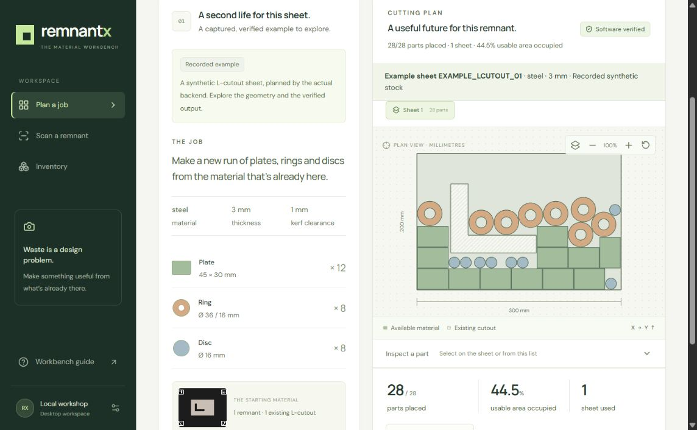
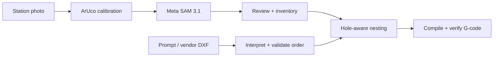

# Remnant X

[](https://github.com/nikunjtrehan/remnant-x/actions/workflows/checks.yml)

**Turn the offcut you have into a cutting plan for the parts you need.**

Remnant X is a desktop prototype for reviewing photographed sheet remnants,
keeping their existing holes, and planning new parts across compatible inventory.
It combines Meta SAM 3.1 perception with model-assisted order interpretation and
deterministic geometry.



*Actual application screenshot. The key-free example uses a synthetic station and
recorded, software-verified backend output. It is separate from live SAM processing.*

[Try the example](#try-the-example-no-api-keys) ·
[Run the live workflow](#run-the-live-workflow) ·
[Measured physical tests](docs/architecture/PHYSICAL_VALIDATION_20261030.md) ·
[Architecture](ARCHITECTURE.md) ·
[Engineering decisions](https://nikunjtrehan.github.io/remnant-x/engineering-decisions/)

## The workflow

A usable offcut can have an awkward boundary and several holes. Its bounding
rectangle alone does not describe the material available for a new job.

1. **Capture:** upload one station photo per remnant, individually or in a ZIP.
   Missing markers and failed calibration stop before paid segmentation.
2. **Review:** compare the detected outline and every hole with the photograph;
   supply the physical stock ID, material grade and thickness, then accept it.
3. **Request:** describe the job or upload vendor DXFs with quantities.
   Review the interpreted requirements before planning.
4. **Plan:** inspect hole-aware nesting across compatible sheets and download
   the final software-verified G-code. A partial job cannot update stock.
5. **Record:** after actual cutting, explicitly report completion of the exact
   reviewed program. All affected sheets update atomically; stale plans are blocked.

Workers do not enter measurements of existing holes. Ruler measurements in our
validation reports are independent test references, never model inputs.

## Try the example (no API keys)

Requires Node.js 22.12 or newer and npm.

```powershell
git clone https://github.com/nikunjtrehan/remnant-x.git
Set-Location 'remnant-x/Front End'
npm ci
npm run dev
```

Open the printed local address, normally `http://127.0.0.1:5173`. Choose
**Example** or **Guided walkthrough** to inspect the recorded 28-part layout,
existing cutout, planned paths and verified output. The backend is not required
for this example. A localhost address works only while its server is running
on your computer; it is not a hosted demo.

## Run the live workflow

Requires Python 3.11, the frontend above, a calibrated four-marker station,
Meta API access for SAM and a configured order provider for model-assisted parsing.
For an existing checkout, reuse its virtual environment and `.env`.

From the repository root, first-time setup:

```powershell
py -3.11 -m venv .venv
.\.venv\Scripts\python.exe -m pip install -r requirements-dev.txt
if (-not (Test-Path '.env')) {
    Copy-Item '.env.example' '.env'
}
```

Fill the required keys in `.env` using the comments in `.env.example`.
Credentials stay on the backend. Then start a separate trial warehouse:

```powershell
.\scripts\start.ps1 -Demo
```

Keep the API and `npm run dev` running in separate terminals. In **Live workspace**,
scan and review stock, then plan a job. The trial warehouse starts empty; sample
stock is seeded only through an explicit action. Sample/local-threshold stock
requires an explicit planning opt-in.

For a single uploaded DXF, try: **“Make 50 copies of the uploaded DXF from 3 mm
cardboard. Kerf 1 mm.”** Use the actual material and thickness of your stock.
For multiple DXFs, the per-file quantities provide explicit bindings.

The local API documentation is at `http://127.0.0.1:8000/docs` while the API runs.
See the [workflow guide](Front%20End/WORKFLOW_GUIDE.md) for review/recovery behavior
and the [engineering reference](docs/ENGINEERING_GUIDE.md) for API contracts,
supported geometry and equivalent startup commands.

## Architecture



React and TypeScript provide the desktop workbench; one FastAPI service owns
perception, order interpretation, geometry and the SQLite warehouse. Muse Spark
Open interprets orders through Baseten, with configured failover and guarded
Fireworks repair. Muse Code-prepared controller emitters are reused outside the
coding-agent loop. The worker reviews geometry and confirms the exact saved plan
after physical cutting.

See [ARCHITECTURE.md](ARCHITECTURE.md) for system topology, repository layout,
workflow lifecycles, model roles, nesting, verification and storage.

## Evidence and limits

Latest local checks, **31 October 2026**: **211 backend tests**, **49 frontend tests**,
TypeScript checks and a successful production build.

- [Physical test](docs/architecture/PHYSICAL_VALIDATION_20261030.md): two cardboard
  specimens, eight photos, five correct usable topologies and three blocked
  captures. Exterior error reached **7.32 mm**; this is not uniform millimetre
  accuracy. Corrected ruler references were supplied after results.
- [Final integration review](docs/FINAL_READINESS.md): real photo ZIP intake,
  SAM reviews, explicit stock acceptance, a live 50-copy DXF order, saved-plan
  recovery and verified download.
- [Frontend validation](Front%20End/VALIDATION.md) and
  [factory scenarios](Front%20End/FACTORY_SCENARIOS.md) distinguish automatic guards,
  operator checks and deferred work.

This is a supervised local prototype. Metal/glare performance and real-machine
cutting are unqualified. Output uses centerline contours without dimensional
kerf compensation. Supported profiles are `ISO_6983_GRBL` and `LINUXCNC_LASER`;
vendor DXFs accept closed straight polylines and closed planar splines, with declared mm/cm/m/inch units converted to mm. Spline import uses a disclosed 0.05 mm chord tolerance; arbitrary CAD is not supported.
See the [engineering reference](docs/ENGINEERING_GUIDE.md) for precise limits.

## Repository and checks

| Path | Start here for |
| --- | --- |
| [Front End](Front%20End/README.md) | React/TypeScript workbench, rendering and interaction tests |
| [backend/api.py](backend/api.py) → [pipeline.py](backend/pipeline.py) | HTTP boundary and manufacturing workflow |
| [backend/tests](backend/tests) | Offline geometry, model-contract, verification and transaction regressions |
| [docs/architecture](docs/architecture) | Decisions, physical experiments and application-promise audit |
| [Local startup](docs/LOCAL_STARTUP.md), [codebase guide](docs/CODEBASE_GUIDE.md) | Two-terminal setup and a detailed architecture/file reference |
| [benchmarks](benchmarks/README.md), [scripts](scripts) | Evaluation cases, explicit demo startup and opt-in live tools |

From the root: `.\.venv\Scripts\python.exe -m pytest -q`.
From `Front End`: `npm run check`. Tests use offline providers; live smoke tests
are separate and opt-in. The [Checks workflow](.github/workflows/checks.yml)
runs these checks on push and pull requests. [View hosted results.](https://github.com/nikunjtrehan/remnant-x/actions/workflows/checks.yml)

To view engineering decisions, visit [the engineering decisions website](https://nikunjtrehan.github.io/remnant-x/engineering-decisions/).
