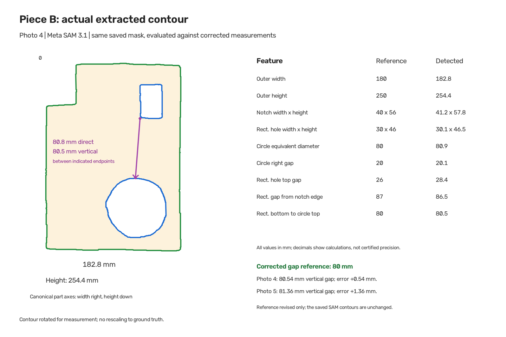

# Two-piece cardboard validation — 30 October 2026

The calibrated production endpoint recovered the correct topology in five usable
captures of two specimens. Six real SAM calls were made: five successful captures
and one rejected clipped capture. Two further photos stopped before SAM.
This supports a cardboard demonstration; it does not establish uniformly ±5 mm
accuracy or qualify metal cutting.

## Inputs and reference revisions

The station was confirmed unchanged: black-marker spans 657/658 mm top/bottom,
509/514 mm left/right, black marker square 48 mm. The existing rectangular
approximation remains 657.5 × 511.5 mm at 2 px/mm. It was not fitted to either
specimen. Both specimens are cardboard, 3 mm thick.

Piece A uses the previously supplied 319 × 289 mm exterior and enclosed L-hole
references. Its 69/73 mm left/top offsets were corrected during the earlier
experiment. Piece B initially supplied a 180 × 250 mm exterior, 40 × 50 mm notch,
40 × 50 mm rectangular hole, 80 mm circular-hole diameter and 20 mm right gap.

After seeing the differences, the user physically remeasured B and revised the
notch height to **56 mm**, rectangular hole to **30 × 46 mm**. They confirmed a
**26 mm** rectangular-hole top offset and **87 mm** left gap measured from the
notch's inner vertical edge. Initial references are retained privately. These
corrections followed the estimates: this is **not a blind validation**.

No specimen measurements were sent to SAM. Saved masks and geometry were not
rerun, rescaled, repaired or filtered after reference revision.

## Actual capture outcomes

Each passing image followed the real API: original photo → 16-corner ArUco
calibration → rectification → fiducial masking → Meta SAM 3.1 concept
`cardboard sheet` → unmodified topology vectorization → DXF and pending review.
CLAHE, region boxes, surface auditing and threshold fallback were off.
The baseline backend state was commit `0e32bc7`.

| Photo | Scene | Observed outcome |
| --- | --- | --- |
| 1 | A, near overhead | One exterior, one L-shaped hole; HTTP 200 |
| 2 | A, rotated | One exterior, one L-shaped hole; HTTP 200 |
| 3 | A, oblique | One exterior, one L-shaped hole; HTTP 200 |
| 4 | B, near overhead | One notched exterior and exactly two holes; HTTP 200 |
| 5 | B, rotated | One notched exterior and exactly two holes; HTTP 200 |
| 6 | B, marker covered by hand | Missing ID 2 rejected before SAM; IDs 0/1/3 detected |
| 7 | B, oblique, uneven lighting | All four IDs detected, but rectified-marker check failed; rejected before SAM |
| 8 | B, outside station | Calibration passed; mask had two exterior components and one enclosed hole; `ERR_MULTIPLE_SHEETS` |

Photo 8's smaller fragment has contour area 11 px² (2.75 mm² at this scale).
It was not discarded to obtain a pass. This was a topology rejection, **not proof
that a dedicated crop classifier identified the cause**. No stock was added.
Worker guidance now includes keeping the full remnant inside the station.

Photo 7 does not prove that lighting alone caused failure: pose, image quality
and rectification were not isolated. Guidance recommends recapturing before
checking station setup.

Successful captures took 5.15–9.86 s overall. SAM transport took 4.88–9.59 s across
the six calls. These are single observations per photo, not a latency benchmark,
price estimate or reliability rate.

## Measurement method

Exterior dimensions use the minimum-area enclosing rectangle of the detected
outer contour. Observed long/short sides assign axes; the L opening or notch
determines orientation. No dimensions are fitted to references. B's width points
right and height down, with its notch at top-left.

Hole spans/offsets use these detected part axes. B notch width/height use
cross-sections at 5% of observed exterior height/width. A arm widths use 25% of
observed hole height and 75% of observed hole width. B's two holes are classified
by area relative to their enclosing rectangles without changing contours.
Equivalent circle diameter comes from detected area.

Decimals report arithmetic, not certified precision. Ruler resolution and
measurement uncertainty were not supplied.

## Piece B comparison

All values are millimetres. The notch is exterior geometry, not a third hole.

| Feature | Revised reference | Photo 4 | Photo 5 |
| --- | ---: | ---: | ---: |
| Outer width | 180 | 182.8 | 183.5 |
| Outer height | 250 | 254.4 | 255.3 |
| Notch width | 40 | 41.2 | 40.9 |
| Notch height | 56 | 57.8 | 58.8 |
| Rectangular hole width | 30 | 30.1 | 30.3 |
| Rectangular hole height | 46 | 46.5 | 46.4 |
| Rectangular hole top offset | 26 | 28.4 | 29.0 |
| Rectangular hole gap from notch's vertical edge | 87 | 86.5 | 86.9 |
| Circle horizontal span | 80 | 81.0 | 80.3 |
| Circle vertical span | 80 | 80.5 | 80.7 |
| Circle equivalent-area diameter | 80 | 80.9 | 80.5 |
| Circle right gap | 20 | 20.1 | 20.4 |
| Rectangle bottom to circle top, vertical gap | 80 | 80.5 | 81.4 |

B's largest scored internal-feature/notch error is 3.04 mm. Exterior height error
reaches 5.27 mm. Idealized revised usable area is 36,353.45 mm²; extracted areas
are 36,936.75 and 37,204.88 mm² (+1.60% and +2.34%). Area agreement can conceal
local boundary errors.

### Corrected rectangle-to-circle gap

The user corrected the previously supplied 125 mm measurement to **80 mm**
(8 cm). The earlier reference and comparison are retained privately as revision
history; there is no remaining reference-closure conflict.

Observed rectangle-bottom to circle-top vertical gaps are **80.54 / 81.36 mm**,
errors of **+0.54 / +1.36 mm** against the corrected reference. Distances between
the rectangle bounds' bottom-left and detected circle's topmost point are
**80.78 / 81.39 mm**, errors of **+0.78 / +1.39 mm** if measured directly between
those endpoints. The diagram distinguishes vertical separation from direct
distance. Both interpretations agree closely with the corrected 80 mm reference.

The corrected vertical reference stack is `26 + 46 + 80 + 80 = 232 mm`, leaving
18 mm below the circle within the 250 mm exterior. Saved model results and
contours were unchanged; only the comparison reference and report were updated.
This correction also followed the estimates and is not blind validation.

## Piece A repeat captures

| Measurement, mm | Reference | Photo 1 | Photo 2 | Photo 3 |
| --- | ---: | ---: | ---: | ---: |
| Outer width | 319 | 322.9 | 325.0 | 325.5 |
| Outer height | 289 | 291.6 | 292.2 | 296.3 |
| L-hole width | 158 | 159.4 | 160.6 | 161.9 |
| L-hole height | 156 | 159.8 | 158.7 | 158.2 |
| Vertical arm width | 25 | 27.0 | 26.5 | 27.2 |
| Horizontal arm height | 53 | 52.5 | 53.4 | 51.3 |
| Hole left offset | 69 | 68.0 | 69.4 | 68.6 |
| Hole top offset | 73 | 73.3 | 74.8 | 77.1 |

Topology is stable across these views. Largest scored error: **7.32 mm**, A's
exterior height in the oblique photo. The proposed ±5 mm cardboard-demo target
is met across scored features in photos 1 and 4; photos 2, 3 and 5 exceed it on
at least one exterior dimension. No formal industrial tolerance was established.

Station approximation, specimen height above the marker plane, hand-cut edges,
pose and segmentation can contribute; their individual effects were not isolated.
Passing an internal marker check does not certify independent physical accuracy.

## Downstream checks on the actual extracted geometry

A private SQLite warehouse accepted one reviewed view of each physical piece.
Three repeat views were rejected; accepting another view with the same physical
stock ID failed. Exactly two stock records remained available.

| Check | Actual result |
| --- | --- |
| Vendor DXF | Generated closed straight 20 × 15 mm LWPOLYLINE with explicit mm units; real upload endpoint |
| “Make 50 copies” | Real Baseten Muse Spark parsing; 50/50 placed on one sheet; final program verified |
| Fifty-copy timing | 4.65 s total: parsing 2.95 s, nesting 1.37 s, compile/verification 0.26 s |
| Nine 120 × 50 mm rectangles | 9/9 placed: 7 on A, 2 on B; both programs verified; 0.62 s observed |
| Independent geometry checks | Placements covered by extracted stock; no pairwise overlap or intersection with existing holes |
| Preview/recovery | Inventory unchanged; saved fifty-copy plan recovered exact final programs |
| Protected files | Production DB files, `.env` and backend Python unchanged |
| Physical fabrication | None; no machine connection or cut-complete transaction |

These are live API integration checks, separate from the earlier browser exercise
with explicitly substituted offline perception. Software verification uses the
extracted geometry; it does not establish machine registration, cutting settings,
achieved dimensions, optimal packing or savings.

## Conclusion and evidence

There is real SAM evidence for a non-convex exterior, different enclosed hole
shapes, rotation, perspective, blocked captures, physical-stock identity and
complete verified multi-sheet planning. No model integration or geometry code
change was needed for these specimens.

This remains a supervised cardboard prototype. The reference discrepancy is
resolved; exterior accuracy varies with capture, metal/glare performance remains untested,
and a fresh operator walkthrough is separate work. Demo claims should retain
these measured errors and limits.

Original photos, response streams, model inputs/masks, overlays, hashes,
reference revisions, DXFs and API responses remain in the ignored local experiment
directory. Only this report and the geometry-only diagram are intended for the
public repository.
